<picture>
  <source media="(prefers-color-scheme: dark)" srcset="docs/screenshots/hero-dark.webp">
  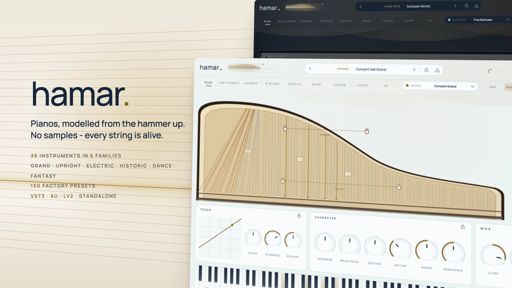
</picture>

# Hamar

A physically modelled piano for every common DAW – VST3, Audio Unit, LV2 and a standalone app. No samples: every
note is computed as it sounds, from a felt hammer striking stiff strings that are coupled at the bridge, a soundboard
with hundreds of modes and microphones you place around the instrument. 36 instruments in six families – grands,
uprights, electric pianos, historic keyboards, dance pianos and fantasy instruments – each with its own controls,
plus a pad layer, chords and strums, the condition of an old instrument, sixteen effects and 150 factory presets.
*Hamar* is Old Norse for hammer – the part of a piano that makes the sound; it is the fourth instrument from Fjord and
shares its Scandinavian, minimal interface (light and dark).

[](https://github.com/fjord-sounds/hamar/actions/workflows/ci.yml)
[](LICENSE)

> **Made with AI.** Hamar – the plugin code, the user interface, the tests and all factory presets – was written
> entirely by AI with Claude, directed by prompts. Nothing is hand-programmed or hand-tuned.
> The code is open so you can read it, test it and judge for yourself; bug reports and pull requests are welcome.

<p>
  <a href="#a-tour">Tour</a> ·
  <a href="#instruments">Instruments</a> ·
  <a href="#sound-architecture">Sound architecture</a> ·
  <a href="#effects">Effects</a> ·
  <a href="#presets">Presets</a> ·
  <a href="#building">Building</a> ·
  <a href="#tests">Tests</a>
</p>

## Lightweight

About 5 MB per plugin format, with nothing to download: no samples, no account, no network. The physical model runs
at 6–12 % of one core with sixty keys sounding (measured on Apple silicon); four quality levels (Eco, Standard, High,
Render) trade strings per key, string stiffness, soundboard density and the number of keys sounding at once against
CPU. The audio thread never allocates or locks.

## Works in your DAW

| Format | Platforms | Hosts (examples) |
|---|---|---|
| **VST3** | macOS, Windows, Linux | Ableton Live, Bitwig Studio, Cubase, FL Studio, Studio One, Reaper, Ardour |
| **AU** | macOS | Logic Pro, GarageBand, MainStage |
| **LV2** | Linux | Ardour, Carla, Qtractor |
| **Standalone** | macOS, Windows, Linux | no DAW needed |

- **Pedals**: sustain with half pedalling (CC 64 is read continuously), sostenuto (CC 66) and una corda (CC 67). The
  sustain pedal on screen can be held with a click.
- **Key pressure**: polyphonic aftertouch, channel pressure and MPE pressure (per channel) play the clavichord's
  Bebung (the pitch rises as you press) and the bow of the bowed piano; the pianos ignore it, as a real piano does.
- **Scala tunings**: load any `.scl` file – twelve-note scales work like a temperament on the chosen key, other scales
  are laid out over the keys (microtonal). The tuning is saved with the project and with presets.
- **Automation**: every control is a host parameter (236 of them); presets show up as programs.
- **Any block size and sample rate**: oversized host blocks are split internally; the strings are tuned exactly at
  44.1 to 192 kHz.
- **Tempo sync**: delays, tremolo and motion effects follow the host tempo.

## A tour

### Play

<picture>
  <source media="(prefers-color-scheme: dark)" srcset="docs/screenshots/play-dark.webp">
  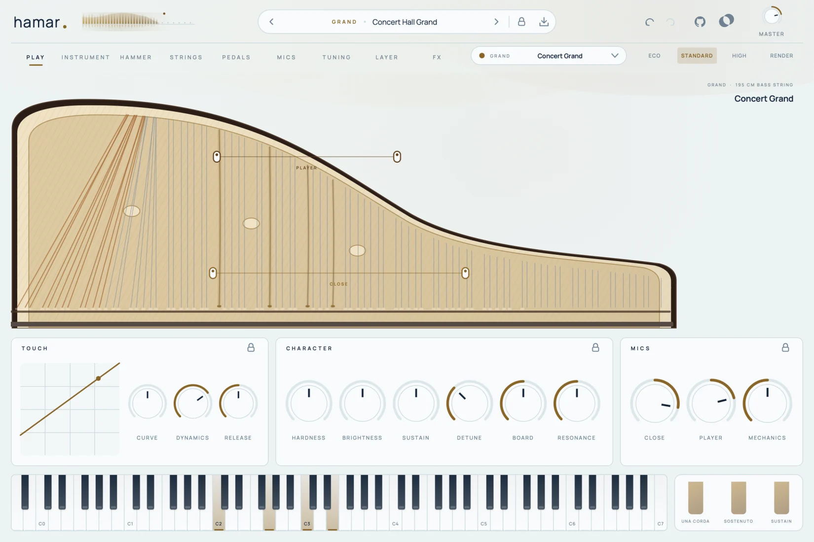
</picture>

The instrument from above: every string lies right above its key on the keyboard, as long as the model's string is,
the wound bass strings crossing over the tenor. Strings glow and shake while they sound, hammers jump when they
strike, the dampers lift with the keys and the pedal, and the two microphone pairs can be dragged inside the
instrument. Below: the touch (how velocity becomes hammer speed – drag the curve), the knobs that change the
character most, and the mic levels. Electric models show their tines or reeds, their character and the amp:

<picture>
  <source media="(prefers-color-scheme: dark)" srcset="docs/screenshots/electric-dark.webp">
  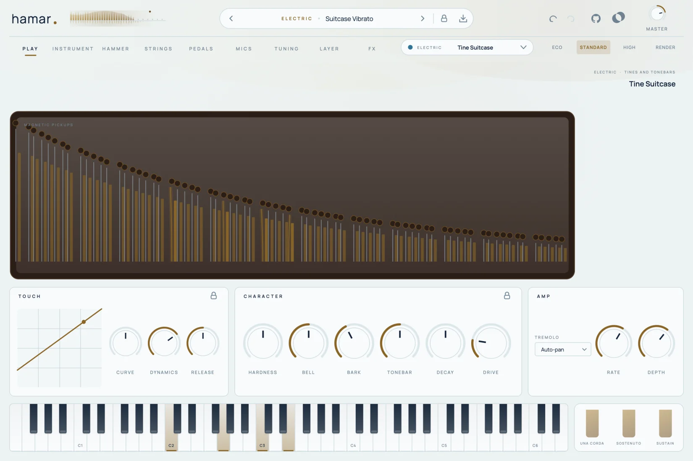
</picture>

### Instrument

<picture>
  <source media="(prefers-color-scheme: dark)" srcset="docs/screenshots/instrument-dark.webp">
  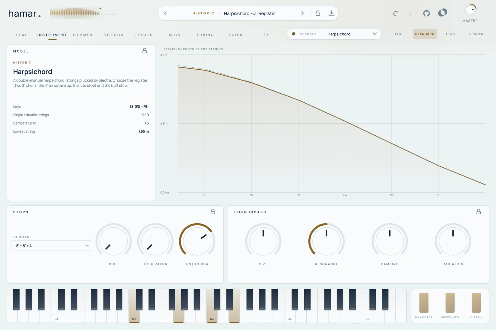
</picture>

The model with its facts (keys, strings per key, dampers, the lowest string), the speaking length of its strings, and
the controls of its family: the lid, rim and aliquot of a grand, the panel, cabinet and wall of an upright, the pickups
and amp of an electric piano, the stops of a harpsichord or fortepiano (register, buff, moderator), the organ layer,
stab, punch and tape of the dance pianos, the bars, preparations and bow of the fantasy instruments – and the
soundboard (size, resonance, damping, radiation).

### Hammer

<picture>
  <source media="(prefers-color-scheme: dark)" srcset="docs/screenshots/hammer-dark.webp">
  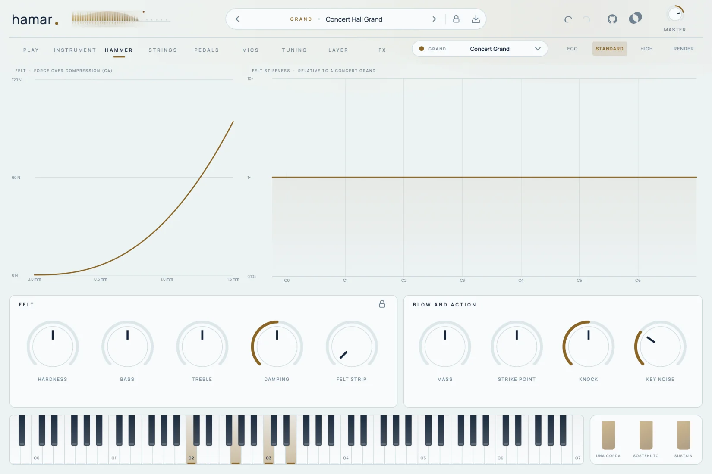
</picture>

The felt: its force over compression on the middle C (now and as the model comes) and its stiffness over the keyboard.
Hardness, bass and treble voicing, the felt's damping, the felt strip of the felt pianos, the hammer mass, the strike
point, the knock of the blow and the noise of the keys.

### Strings

<picture>
  <source media="(prefers-color-scheme: dark)" srcset="docs/screenshots/strings-dark.webp">
  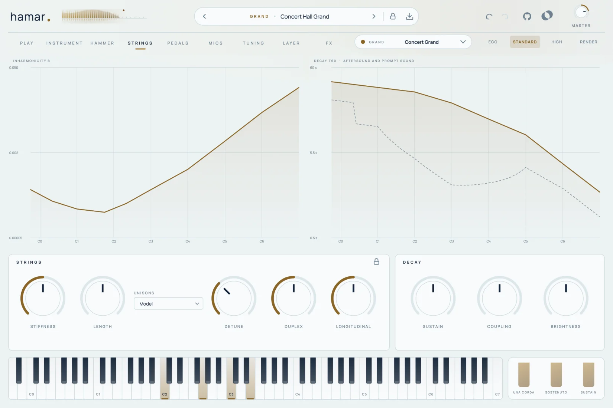
</picture>

Inharmonicity and decay (aftersound and prompt sound) over the keyboard, as the model computes them. Stiffness, string
length, unisons and their detuning, the duplex scale, the longitudinal motion (the shock of a hard bass note, the
phantom partials), sustain, bridge coupling and brightness.

### Pedals

<picture>
  <source media="(prefers-color-scheme: dark)" srcset="docs/screenshots/pedals-dark.webp">
  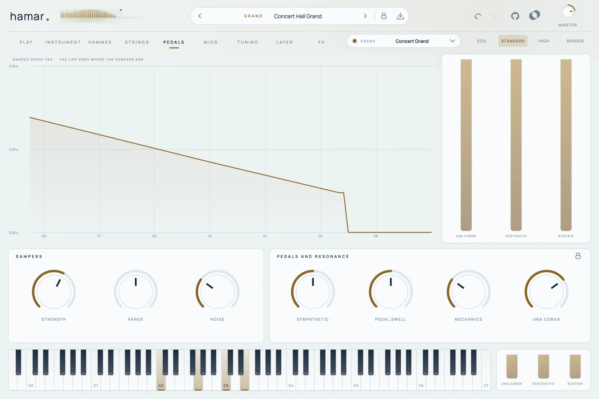
</picture>

The dampers – how fast they stop the strings, how far up they reach, their noise – and the pedals: the sympathetic
strings that ring along when the dampers are up, the swell of the dampers lifting, the pedal mechanics and the depth of
the una corda.

### Mics

<picture>
  <source media="(prefers-color-scheme: dark)" srcset="docs/screenshots/mics-dark.webp">
  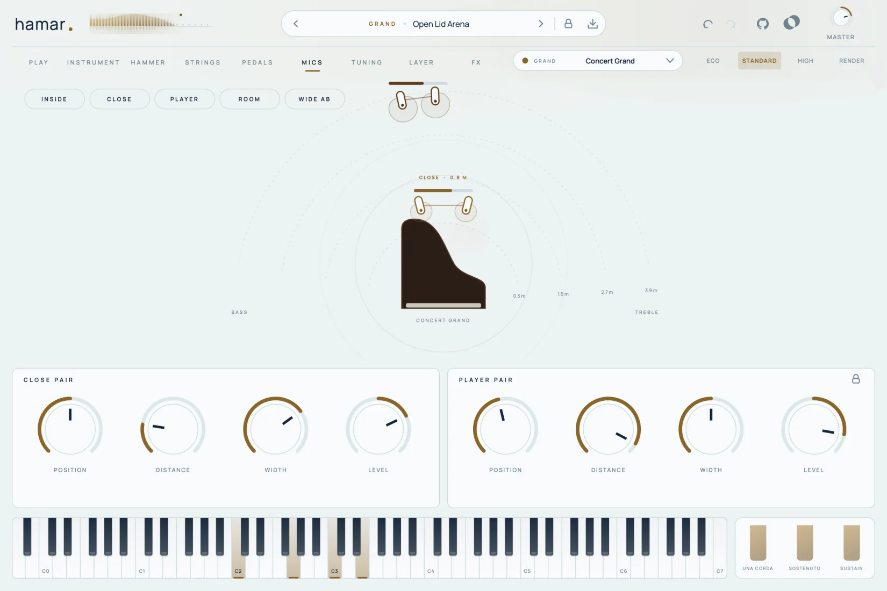
</picture>

Two microphone pairs on a stage around the instrument: drag a pair to move it (left is the bass side, further out is
further away), drag a capsule or scroll to change its width; each pair shows its pickup pattern and what it hears.
Quick placements: inside, close, player, room, wide AB.

### Tuning

<picture>
  <source media="(prefers-color-scheme: dark)" srcset="docs/screenshots/tuning-dark.webp">
  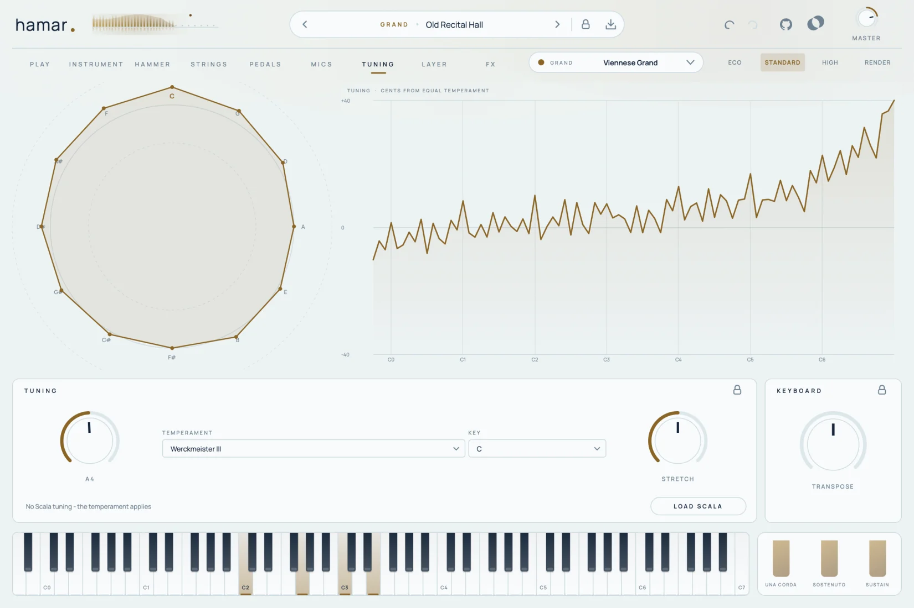
</picture>

Seven temperaments (equal, Werckmeister III, Vallotti, Kirnberger III, meantone, just, Pythagorean) on a circle of
fifths – click a note to build the temperament on it – and the stretch a piano tuner gives this model, computed from
its inharmonicity (octaves matched on the partials). Load a Scala tuning (`.scl`) instead of the temperament.
Reference pitch and transposition.

### Layer

<picture>
  <source media="(prefers-color-scheme: dark)" srcset="docs/screenshots/layer-dark.webp">
  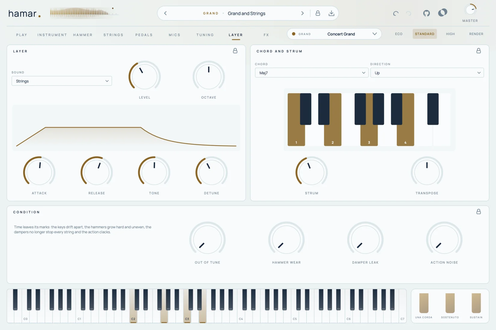
</picture>

A pad, strings or air under the piano, following the keys and the pedal; chords from one key (octave, fifth, major,
minor, major and minor sevenths, sus2, power) strummed up, down or alternating; and the condition of an old instrument
– keys drifted out of tune, worn hammers, leaking dampers, a noisy action.

### FX

<picture>
  <source media="(prefers-color-scheme: dark)" srcset="docs/screenshots/fx-dark.webp">
  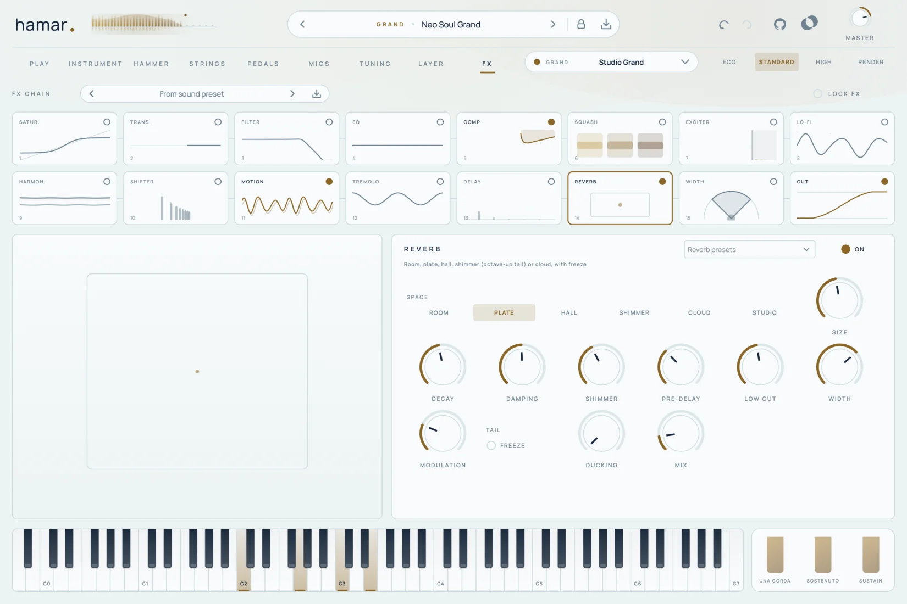
</picture>

The effects of the Fjord family: fifteen tiles in two rows and the clipper at the end. Drag a tile to reorder the chain,
load and save whole chains in the FX CHAIN bar, and lock the effects while you browse sounds.

### Presets and locks

<picture>
  <source media="(prefers-color-scheme: dark)" srcset="docs/screenshots/browser-dark.webp">
  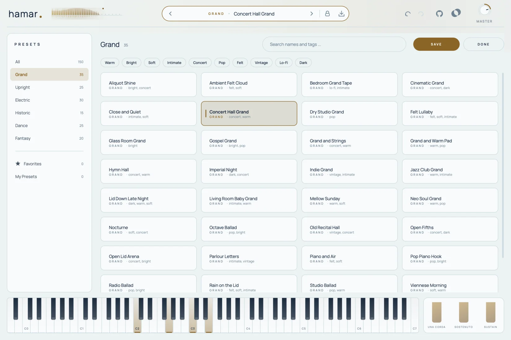
</picture>

The browser has the six families as categories, tags, favourites and search. The padlock in the preset bar keeps parts
of the sound when you switch presets – the model, touch and chords, tuning, mics, hammers, strings, dampers and pedals,
soundboard and case, the family settings, the layer, the condition, the whole effect chain or single effects.

## Instruments

| Family | Models | What makes the sound |
|---|---|---|
| **Grand** | Concert Grand, Imperial Grand (down to C0), Viennese Grand, Studio Grand, Parlour Grand, Baby Grand, Pop Grand, Felt Grand | felt hammers, up to three strings per key, soundboard, lid |
| **Upright** | Studio Upright, Home Upright, Spinet, Felt Upright, Honky-Tonk, Tack Piano | shorter, more inharmonic strings, a smaller board, cabinet and wall |
| **Electric** | Tine Stage, Tine Suitcase, Reed 200, Electric Grand, Pianet, Clav | tines with tonebars and magnetic pickups, reeds with electrostatic pickups, piezo-picked strings – through an amp with drive, tone and tremolo / auto-pan |
| **Historic** | Fortepiano 1795, Fortepiano 1820, Square Piano, Harpsichord, Clavichord | leather hammers and thin strings, plucking plectra with registers and buff stop, a tangent |
| **Dance** | House Stab, 90s Rave Piano, Deep House Keys, Garage Piano, Lo-Fi Tape Piano | string models with the organ layer of the classic house piano, punch, stabs and tape |
| **Fantasy** | Glass Piano, Ice Crystal, Prepared Piano, Toy Piano, Celesta, Bowed Piano | struck plates, rods and bells, prepared strings (bolts, rubber, screws), a bowed string |

Every parameter is an offset around the model's own voicing, so a sound keeps its character when you change the model.

## Sound architecture

| Part | How it works |
|---|---|
| Hammer | a mass on a nonlinear felt spring (force ~ compression^p, with hysteresis), simulated against the string with sub-steps – a harder blow compresses the felt where it is stiffer, so the tone gets brighter by itself; hammer masses, felt stiffness and strike points follow a concert grand and were checked against recordings |
| Strings | digital waveguides cut at the strike point: losses, stiffness (a cascade of allpasses designed so the partials follow f·n·√(1+Bn²)) and a fine-tuning allpass; one to three strings per key, slightly detuned and struck a little unevenly |
| Bridge | a frequency-dependent coupling of the strings: low partials hand their energy to the board quickly, high ones ring on; strings moving against each other ring for a long time (the aftersound) and still radiate, as the strings cross the bridge a little apart |
| Longitudinal motion | the stretch of the string (squared displacement) drives the longitudinal modes – the shock at the start of a hard bass note and the phantom partials |
| Dampers and pedals | dampers that settle at the speed of the key, half pedalling, sostenuto, una corda (one string less, softer felt), undamped treble strings, damper and pedal noises |
| Sympathetic strings | every free string listens to the bridge and rings along |
| Soundboard | an impulse response synthesized from hundreds of plate modes (density, damping, radiation from the model's size, rim or cabinet resonances, a different mix for every mic position), convolved without latency |
| Microphones | two stereo pairs: position along the instrument, distance (level, air, delay, more body), width, lid or panel |
| Bars | tines, reeds, plates, rods and bells as banks of resonators with their own mode ratios, struck by a force pulse (or plucked), with nonlinear magnetic and electrostatic pickups |
| Plectrum and bow | a stiff spring that bends the string until it slips; a friction bow that holds the string while the key is down |
| Tuning | temperaments and the stretch derived from the model's inharmonicity |
| Output | piano → preset level → effects (in your order, clipper last) → master |

## Effects

Hamar uses the effects of [fjord-base](https://github.com/fjord-sounds/fjord-base), the code all Fjord plugins share:
Saturation, Lo-Fi, Transient, Compressor, Squash, EQ, Filter, Motion (chorus, ensemble, phaser, flanger, doubler,
vibrato), Delay, Reverb (room, plate, hall, shimmer, cloud, studio, freeze), Width, Tremolo / Auto-Pan, Frequency
Shifter, Exciter, Harmonizer and the Clipper. Every effect has at least 40 presets and also exists as a plugin of its
own ("Fjord Reverb" …). All parameters:
[fjord-base/docs/effects.md](https://github.com/fjord-sounds/fjord-base/blob/main/docs/effects.md). The filter envelope
follows the notes you play.

## Presets

150 factory presets in the six families – Grand (35), Upright (25), Electric (30), Historic (15), Dance (25) and
Fantasy (20) – one sound idea each, in the direction of pop, soft and bedroom piano, house and dance, with room for
classical and experimental sounds. All are loudness matched on chords (their loudest moment), with headroom so the
clipper at the end of the chain stays out of normal playing. The quality level and the master volume are yours:
presets never change them. Your own presets go to `~/Music/Fjord/Hamar/Presets`.

## Building

Requirements: CMake 3.22+, a C++20 compiler (Xcode command line tools, Visual Studio 2022 or GCC/Clang on Linux).
Hamar is built on [fjord-base](https://github.com/fjord-sounds/fjord-base), the code all Fjord plugins share (interface,
effects, build helpers): **clone it next to this repository** (`git clone https://github.com/fjord-sounds/fjord-base
../fjord-base`) – without it CMake downloads the release pinned in `CMakeLists.txt` (`FJORD_BASE_TAG`). JUCE 8 comes
through fjord-base.

```bash
git clone https://github.com/fjord-sounds/fjord-base.git
git clone https://github.com/fjord-sounds/hamar.git && cd hamar
cmake -S . -B build -DCMAKE_BUILD_TYPE=Release
cmake --build build -j8
```

On macOS, `./build.sh` builds AU, VST3 and the standalone app, installs the plugins and validates the AU with
`auval`. Linux needs the usual JUCE packages (ALSA, X11, Freetype, fontconfig, GL headers).

## Tests

```bash
cmake --build build --target HamarRenderTest -j8
./build/HamarRenderTest_artefacts/Release/HamarRenderTest build/renders      # must print ALL PASSED (also with --sr 96000)
```

The test renders without a DAW and checks: the zero-latency convolution against a plain one, the tuning of the first
partial (within 1.5 cents) and the stiff-string partials, touch (a hard blow is louder and brighter), una corda,
dampers, sustain and half pedal, sympathetic strings, chords and the layer, the condition, key pressure (Bebung),
Scala tunings (19 steps, just intonation, project round trip), every model over the whole
keyboard, odd block sizes, project round trips and every factory preset on a chord progression (it must stay below
full scale before the clipper). Other modes: `--single`, `--demo`, `--midi <file> <preset> <out.wav>`, `--midi-scan
<file>` (every preset with a MIDI file: peaks, clipping, treble), `--analyse <note>` (partials against the
stiff-string formula and the decay), `--compare <recording> <note> <velocity>` (measures a recording against Hamar),
`--cpu`, `--screenshot`, `--loudness`, `--param-info`, `--icon`. The README
images are made by `tools/screenshots/shoot.sh`.

## Licence

Hamar is free software under the [GNU Affero General Public License v3](LICENSE). See
[THIRD_PARTY_NOTICES.md](THIRD_PARTY_NOTICES.md) for fjord-base, JUCE and the Manrope font.
